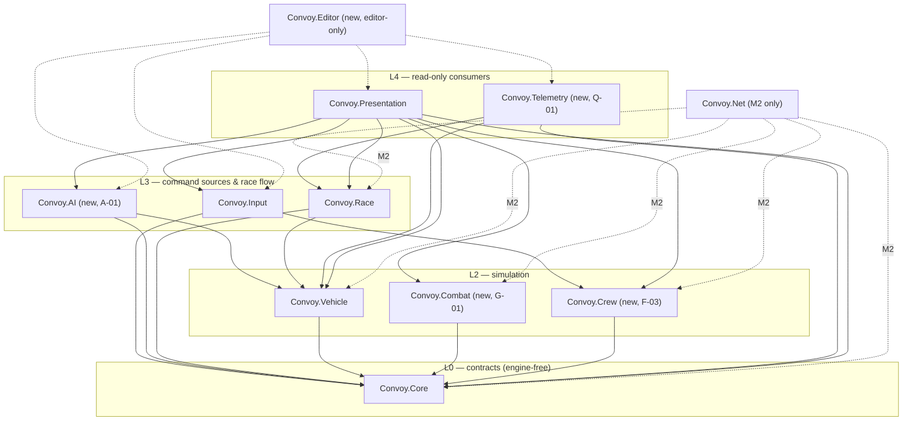

# ADR-001 — Module & assembly map (M1, with M2 netcode slot)

- **Status:** Proposed (architect, ARCH-001, 2026-10-11) · **Human owner/reviewer:** Lead Dev (architecture, D-010) + Gabriel
- **Refines:** `TECH_DESIGN.md` § Architecture, D-007. **Proposes:** D-016 (below).

## Context
Today the project has five runtime assemblies (Core, Vehicle, Input, Race, Presentation) plus one EditMode test assembly. Batch 2 adds seats/stations, damage, AI driving, a Cinemachine camera and telemetry, built **in parallel by different agents**. Two things must hold:
1. No agent can create a cycle or let simulation depend on presentation (D-007).
2. Parallel tasks must not edit the same files (asmdefs, `VehicleController.cs`) at the same time.

### Unity background (for reviewers new to Unity)
- An **assembly definition** (`.asmdef`) turns a folder into its own compiled DLL. A script can only use types from assemblies its asmdef lists in `references`. Unity **refuses to compile a reference cycle**, so the asmdef graph *is* our dependency rule, enforced by the compiler — not just by review.
- `"noEngineReferences": true` (set on `Convoy.Core`) means the assembly cannot use `UnityEngine` at all: no `Vector3`, `MonoBehaviour`, `Pose`. Core types therefore use plain `float`/`int`/`bool`. This keeps commands trivially serializable for M2 netcode and testable anywhere. **Keep it.**
- `autoReferenced: true` lets Unity's default `Assembly-CSharp` see the module. Leave as is; nothing of ours lives in `Assembly-CSharp`.

## Decision

### Layers (references point downward only)


### Module table
Folder layout stays `Assets/_Convoy/Scripts/<Module>/` (existing code is **not** moved).

| Module (asmdef) | Namespace | Folder | Responsibility | May reference | Must never reference |
|---|---|---|---|---|---|
| `Convoy.Core` *(exists)* | `Convoy.Core` | `Scripts/Core/` | Engine-free contracts: `SeatId`, seat command structs + receiver interfaces, `VehicleId`, `DamageEvent`/`IDamageable`, `ISeatStatus`, `IPowerSupply` (M-01). Data only, no behaviour beyond clamping. | — (`noEngineReferences: true`) | anything, incl. `UnityEngine` |
| `Convoy.Vehicle` *(exists)* | `Convoy.Vehicle` | `Scripts/Vehicle/` | Raycast vehicle, `VehicleConfig`, `VehicleState`, boost, recovery, **health/damage (D-01)**, Engineer station power/heat/repair (M-01/M-02). Implements `IPilotCommandReceiver`, `IDamageable`, later `IEngineerCommandReceiver`. | Core | Combat, Crew, Input, AI, Race, Presentation, Telemetry |
| `Convoy.Combat` *(new, G-01)* | `Convoy.Combat` | `Scripts/Combat/` | Turret station, weapons, ammo, overheat, hit resolution. Applies damage **only via `IDamageable`**; reads weapon power via `IPowerSupply`. Implements `IGunnerCommandReceiver`. | Core | **Vehicle**, Crew, Input, AI, Race, Presentation, Telemetry |
| `Convoy.Crew` *(new, F-03)* | `Convoy.Crew` | `Scripts/Crew/` | Seat assignment (who occupies which seat), station switching (K-01), per-vehicle `VehicleSeats` router (seat → receiver, neutral on vacate, activity counters), `CrewConfig`. | Core | Vehicle, Combat, Input, AI, Race, Presentation, Telemetry |
| `Convoy.Input` *(exists)* | `Convoy.Input` | `Scripts/Input/` | Devices → players → seat commands (`SeatInputRouter`), Input Actions asset, `InputSeatConfig`, view-only input (look-back). Temporary `PilotInputSource` until F-03c. | Core, Crew, `Unity.InputSystem` | Vehicle, Combat, AI, Race, Presentation, Telemetry |
| `Convoy.AI` *(new, A-01)* | `Convoy.AI` | `Scripts/AI/` | Racing-line path following → `PilotCommand`; stuck recovery; later rival gunners and seat assist (O-001). Reads `VehicleState` / `VehicleConfig`. | Core, Vehicle | Input, Combat, Crew, Race, Presentation, Telemetry |
| `Convoy.Race` *(exists)* | `Convoy.Race` | `Scripts/Race/` | Sprint/race flow, checkpoints, finish, results; implements `IRecoveryPointProvider`. | Core, Vehicle | Input, AI, Combat, Crew, Presentation, Telemetry |
| `Convoy.Telemetry` *(new, Q-01)* | `Convoy.Telemetry` | `Scripts/Telemetry/` | Samples state each tick, writes one CSV per race. Read-only like Presentation. | Core, Vehicle, Race (+ Crew/Combat when needed) | Input, AI, Presentation; and **no simulation module may reference Telemetry** |
| `Convoy.Presentation` *(exists)* | `Convoy.Presentation` | `Scripts/Presentation/` | Cameras (C-01), HUD, debug overlay, VFX/audio hooks. Read-only. | every runtime module above + `Unity.InputSystem`, `Unity.Cinemachine` (after D-015) | Editor, Tests, Net |
| `Convoy.Editor` *(new, first integration task F-03c)* | `Convoy.EditorTools` | `Assets/_Convoy/Editor/` | Versioned **integration scripts** (scene/prefab/asset wiring) + menu items. Editor-only. | any runtime module, `UnityEditor` | — (nothing references it) |
| `Convoy.Tests.EditMode` *(exists)* | `Convoy.Tests` | `Tests/EditMode/` | Existing tests for Core/Vehicle/Race/Presentation. | as today | — |
| `Convoy.<Module>.Tests.EditMode` *(new, one per new module)* | `Convoy.<Module>.Tests` | `Tests/EditMode/<Module>/` | Tests for Crew, Input, AI, Telemetry. | that module + its references | — |
| `Convoy.Tests.PlayMode` *(new, D-01b)* | `Convoy.Tests.PlayMode` | `Tests/PlayMode/` | Handling regression, AI completion smoke tests. | runtime modules as needed | — |
| `Convoy.Net` *(M2 only — do not create in M1)* | `Convoy.Net` | `Scripts/Net/` | Netcode adapters: replicate seat commands up, `VehicleState`/race state down (ADR-005). | Core, Vehicle, Combat, Crew, Race, netcode package | Presentation, Input |

**Why separate per-module test asmdefs:** five builders adding their module to the single `Convoy.Tests.EditMode.asmdef` in parallel would conflict on one JSON file every batch. One test assembly per new module removes that conflict. New *Core* or *Vehicle* tests keep going into the existing assembly (it already references both).

**Why `Combat → Core` only (not Vehicle):** Combat and Vehicle can then be built in parallel by different agents, and damage stays a one-way contract (`IDamageable` in Core). Turrets read the vehicle's `Rigidbody` (a `UnityEngine` type) for platform velocity, not `VehicleController`.

**Why `Input → Crew`:** which seat a player occupies is crew logic (F-03 join order, K-01 switching). Input asks Crew; Crew never knows devices.

**Composition (who wires modules together):** in M1 the **scene** is the composition root: serialized references set by integration scripts (e.g. `SeatInputRouter._vehicle → VehicleSeats`). A `Convoy.Game` bootstrap assembly (references everything except Presentation/Editor) is **reserved**, created only if R-01 needs code-level wiring (e.g. spawning rivals). Do not create it speculatively.

### Exact asmdef contents for new modules
Builders create these when their task first needs the folder (Unity generates the `.meta` on import; builders must not invent `.meta` GUIDs — the orchestrator commits the generated metas after the first import).

```json
// Assets/_Convoy/Scripts/Crew/Convoy.Crew.asmdef  (F-03a)
{ "name": "Convoy.Crew", "rootNamespace": "Convoy.Crew", "references": ["Convoy.Core"],
  "includePlatforms": [], "excludePlatforms": [], "allowUnsafeCode": false, "overrideReferences": false,
  "precompiledReferences": [], "autoReferenced": true, "defineConstraints": [], "versionDefines": [], "noEngineReferences": false }
```
- `Convoy.AI` (A-01a): references `["Convoy.Core", "Convoy.Vehicle"]`.
- `Convoy.Telemetry` (Q-01a): references `["Convoy.Core", "Convoy.Vehicle", "Convoy.Race"]`.
- `Convoy.Combat` (G-01, not batch 2): references `["Convoy.Core"]`.
- `Convoy.Input` (F-03b edit): add `"Convoy.Crew"`.
- `Convoy.Presentation` (edits, one per task that needs it): `"Convoy.Crew"`, `"Convoy.Input"` (F-03b), `"Convoy.AI"` (A-01b), `"Unity.Cinemachine"` (C-01a, after D-015).
- `Convoy.Editor` (F-03c): namespace `Convoy.EditorTools` (a namespace ending in `.Editor` shadows Unity's `Editor` base class inside it and causes confusing compile errors), `"includePlatforms": ["Editor"]`, references all runtime `Convoy.*` modules it wires + `Unity.InputSystem`; later integration tasks add references (A-01c: `Convoy.AI`; C-01b: `Unity.Cinemachine`).
- Test asmdefs copy the shape of `Convoy.Tests.EditMode.asmdef` (`overrideReferences: true`, `nunit.framework.dll`, `defineConstraints: ["UNITY_INCLUDE_TESTS"]`, `includePlatforms: ["Editor"]`). The PlayMode one uses `includePlatforms: []`.

### Integration steps (scenes, prefabs, `.asset` files)
Builders never open Unity and never hand-edit `.unity` / `.prefab` / `.asset` YAML (CLAUDE.md). Anything that needs wiring is a **separate integration task** (`<ID>c`/`<ID>b` suffix) whose deliverable is an editor script:
- File: `Assets/_Convoy/Editor/Integration/<TaskId>_<Name>.cs`, menu `Convoy/Integration/<TaskId> <Name>`.
- **Idempotent** (running twice changes nothing), logs every change, **never deletes**: it disables components (`enabled = false`) instead. Removing old components/files needs Gabriel's approval (CLAUDE.md hard limit).
- Uses `ScriptableObject.CreateInstance` + `AssetDatabase.CreateAsset` for configs, `PrefabUtility.LoadPrefabContents` / `SaveAsPrefabAsset` / `UnloadPrefabContents` for prefabs, `EditorSceneManager.OpenScene` / `MarkSceneDirty` / `SaveScene` for scenes.
- The orchestrator runs it in the single Unity Editor (MCP), runs tests, commits the resulting scene/prefab/asset/meta diff on the integration task's branch.

### Execution order inside one physics step
Unity runs `FixedUpdate` of all components in an undefined order unless `[DefaultExecutionOrder(n)]` is set (lower runs first). Commands must reach the vehicle *before* it simulates:

| Order | Component | Why |
|---|---|---|
| −50 | `AiPilot` (A-01b) | produce this tick's `PilotCommand` before the vehicle reads it |
| −40 | `VehicleSeats` (F-03b) | count seat activity for the tick |
| 0 | `VehicleController` (unchanged) | simulate |
| 0 | `SprintController` (unchanged; reads last tick's state — acceptable) | race clock |
| +50 | `RaceTelemetry` (Q-01b) | sample state after simulation |

Human input still arrives in `Update` (per rendered frame) and is latched by the vehicle (existing `_resetLatched`), see ADR-002.

### How Presentation stays read-only (D-007)
1. **Compiler:** no simulation asmdef lists `Convoy.Presentation` or `Convoy.Telemetry`, so simulation cannot call them.
2. **Data shape:** Presentation reads value snapshots (`VehicleState`, `VehicleDamageState`, `SprintRun` getters, `ISeatStatus`) and subscribes to C# events (`SprintController.Finished`, `VehicleDamage.Damaged`). A struct copy cannot mutate the simulation.
3. **Review checklist (reviewer gate):** in `Convoy.Presentation`/`Convoy.Telemetry` there must be no calls to `Set*Command`, `ApplyDamage`, `Repair`, `Rigidbody` setters/`AddForce`, or `transform` writes on simulation objects. Presentation may move only its own objects (cameras, `CameraAnchor`, HUD).
4. **Accepted exception:** UI may issue explicit *flow requests* through a named method (today `SprintController.Restart()`). In M2 these become server requests. No other writes.
5. **Recommended follow-up (small, not in batch 2):** an EditMode "architecture test" that parses every `Convoy.*.asmdef` and asserts the reference table above, so a forbidden reference fails CI-less test runs.

### Where netcode plugs in (M2)
`Convoy.Net` sits beside Input/AI as another **command source** (remote seats) and beside Presentation as another **state consumer** (replicating `VehicleState`, race state). Simulation modules don't change shape: they already take commands through Core interfaces and expose serializable state. See ADR-005.

## Consequences
- + Combat, AI, Crew, Telemetry can be built in parallel; the compiler rejects wrong references.
- + New test assemblies avoid asmdef merge conflicts.
- − More asmdefs (11 runtime/editor/test by end of M1). Each is ~15 lines; acceptable.
- − `Convoy.Core` cannot use `Vector3`; damage/aim data uses floats. Accepted for network-readiness.

## Proposed decisions
**D-016 — Module map & integration-script rule** · Status: Proposed (architect) · Owner: Lead Dev
- Adopt the module table and layer diagram in `docs/adr/ADR-001-modules.md` as the dependency rule. New modules in M1: `Convoy.Crew`, `Convoy.Combat`, `Convoy.AI`, `Convoy.Telemetry`, editor-only `Convoy.Editor`; `Convoy.Net` reserved for M2.
- `Convoy.Core` stays engine-free (`noEngineReferences: true`). `Convoy.Combat` references Core only and applies damage through `IDamageable`.
- One EditMode test assembly per new module; `Convoy.Tests.PlayMode` added by D-01b.
- Scene/prefab/asset changes are delivered as idempotent, never-deleting editor scripts under `Assets/_Convoy/Editor/Integration/`, executed by the orchestrator.
