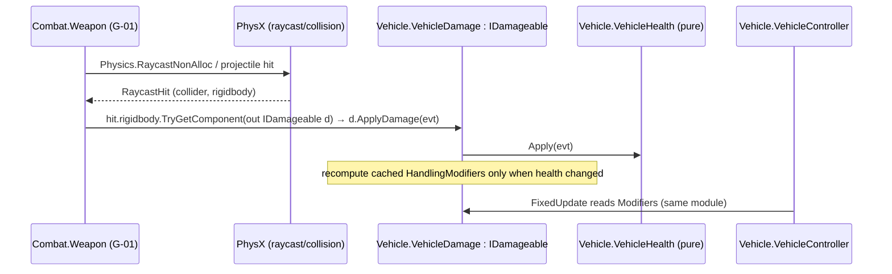

# ADR-003 — Damage & health model

- **Status:** Proposed (architect, ARCH-001, 2026-10-11) · **Human owner/reviewer:** Gabriel (owns D-01, M-02, W-01 per D-010)
- **Serves:** D-01 (damage model), G-01 (hits slow rivals), M-02 (field repair), W-01 (wreck state), Q-01 (damage taken). **Proposes:** D-018.

## Context
- GDD pillar: "managing mechanical damage" is an Engineer decision; M-02 must make repair a *trade-off*; G-01 needs "a hit visibly slows the rival"; W-01 needs a 0-HP state.
- The Jackal was tuned in PT-01 and Gabriel rated it 5/5. **Undamaged handling must be bit-for-bit unchanged.**
- `Convoy.Core` is engine-free; Combat must not reference Vehicle (ADR-001).

## Options considered
| Option | What the Engineer decides | Cost | Verdict |
|---|---|---|---|
| **A. One hull pool + handling degradation** | repair now vs later (blocks other Engineer actions, M-02) | ~6 h, 1 config, 4 multipliers | **Chosen for M1** |
| B. Per-zone (front/rear/left/right) | which side to repair | hit-location maths, 4 HUD bars, unclear gameplay value in greybox | rejected for M1 |
| C. Per-subsystem (engine, steering, weapon) pools | which system to repair first | 3 pools × effects × UI; best Engineer depth | **upgrade path** if PT-02 shows Engineer idle > 40 % (GDD risk 1) |

Option A gives M-02 a real trade-off already (the repair-vs-power/ping tension) at a fraction of the cost. The data model below keeps C cheap: `VehicleHealth` can later hold an array of pools without changing `IDamageable`.

## Decision

### Contracts in `Convoy.Core` (engine-free)
```csharp
namespace Convoy.Core
{
    /// <summary>Stable id of a vehicle in a race (assigned by race setup; None = unknown/environment).</summary>
    [Serializable]
    public struct VehicleId : IEquatable<VehicleId>
    {
        public int Value;                       // 0 = None
        public static VehicleId None => default;
        public bool IsValid => Value > 0;
        public bool Equals(VehicleId other);    // + Equals(object), GetHashCode, ==, !=
    }

    public enum DamageKind : byte { Impact = 0, Projectile = 1, Explosion = 2, Hazard = 3 }

    [Serializable]
    public struct DamageEvent
    {
        public float Amount;          // health points, > 0
        public DamageKind Kind;
        public VehicleId Source;      // who caused it (None = environment/unknown)
    }

    /// <summary>Anything that can take damage. The ONLY way damage enters the simulation (one choke point → server-only in M2).</summary>
    public interface IDamageable
    {
        /// <returns>Health actually removed (0 if ignored, e.g. already wrecked).</returns>
        float ApplyDamage(in DamageEvent damage);
    }
}
```

### How damage reaches a vehicle without Combat → Vehicle

- Unity background: `TryGetComponent<T>` works with **interfaces** and does not allocate, so Combat only needs `Convoy.Core`. Weapons must skip their own vehicle (`hit.rigidbody == ownBody`).
- Collision (impact) damage is computed **inside Vehicle** by `VehicleDamage.OnCollisionEnter` — no other module involved.

### Data: `DamageConfig` ScriptableObject (`Convoy.Vehicle`, menu `Convoy/Damage Config`)
| Field | Default (Jackal) | Meaning |
|---|---|---|
| `maxHealth` | 100 | hull points |
| `impactSpeedThreshold` | 8 m/s | collision Δv below this is free (≈ 29 km/h nudge) |
| `landingSpeedThreshold` | 14 m/s | threshold for contacts whose normal points up (landing a jump, settling after a reset) |
| `landingNormalDot` | 0.7 | contact normal · world-up above this = "landing" contact |
| `impactDamagePerMps` | 2.5 | HP per m/s of Δv above the threshold |
| `maxImpactDamage` | 35 | cap per impact (3 big crashes ≈ near-wreck) |
| `impactWindowSeconds` | 0.25 | multi-contact bounces inside this window count once (largest wins) |
| `degradeBelowHealth01` | 0.6 | above 60 % health: **no handling effect** |
| `minTopSpeedMultiplier` | 0.75 | at 0 HP |
| `minEngineForceMultiplier` | 0.70 | at 0 HP |
| `minGripMultiplier` | 0.80 | at 0 HP, applied to front and rear lateral grip |
| `minSteerMultiplier` | 0.90 | at 0 HP |

Δv is `collision.impulse.magnitude / rigidbody.mass` — the velocity change the crash actually imposed (accounts for both bodies' masses). Worked example: head-on into a canyon wall at 100 km/h (27.8 m/s, Δv ≈ 28) → (28 − 8) × 2.5 = 50 → capped at 35 HP.

**Degradation curve** (deliberately linear with a dead zone, 2 numbers per stat, instead of `AnimationCurve`: easier to reason about, test and network):
```
m(h) = h >= degradeBelow ? 1 : lerp(minMultiplier, 1, h / degradeBelow)      h = health01
```
At full health every multiplier is **exactly 1.0f**, and `x * 1.0f == x` in IEEE floats, so undamaged handling is bit-identical to today.

### Pure logic (`Convoy.Vehicle`, no MonoBehaviour, EditMode-tested)
```csharp
public struct HandlingModifiers                    // multipliers applied by VehicleController
{
    public float TopSpeed, EngineForce, Grip, Steer;
    public static HandlingModifiers None { get; }  // all exactly 1f
    public static HandlingModifiers FromHealth(float health01, DamageConfig config);
}

public static class ImpactDamage
{
    /// <summary>Raw damage for one contact. 0 below the (normal-dependent) threshold.</summary>
    public static float Compute(float deltaV, float normalUpDot, DamageConfig config);
}

/// <summary>Counts multi-contact bounces once: inside a window only the excess over the window's max is new damage.</summary>
public sealed class ImpactWindow
{
    public ImpactWindow(DamageConfig config);
    public float Filter(float rawDamage, double time);
}

[Serializable]
public struct VehicleDamageState
{
    public float Health, MaxHealth;
    public float TotalDamageTaken;   // cumulative, never decreases (telemetry)
    public int HitCount;             // events with Amount > 0 applied
    public bool Wrecked;             // Health <= 0
    public float Health01 => MaxHealth > 0f ? Health / MaxHealth : 0f;
}

public sealed class VehicleHealth
{
    public VehicleHealth(DamageConfig config);
    public VehicleDamageState State { get; }
    public float Apply(in DamageEvent damage);  // ignores <= 0 / NaN; clamps at 0; returns applied
    public float Repair(float amount);          // clamps at max; no effect when Wrecked (W-01 decides revival); returns applied
    public void Restore();                      // full health, keeps TotalDamageTaken
}
```

### Runtime adapter and controller hook (D-01b)
- `VehicleDamage : MonoBehaviour, IDamageable` on the vehicle root: holds `VehicleHealth`, `ImpactWindow`, cached `HandlingModifiers`; `OnCollisionEnter` → Δv + first contact normal → `ImpactDamage.Compute` → `ImpactWindow.Filter` → `ApplyDamage` with `Kind = Impact` and `Source` = the other vehicle's `VehicleDamage.Id` if any. Exposes `State`, `Modifiers`, `Id { get; set; }`, `Repair(float)`, `event Action<DamageEvent> Damaged` (presentation only).
  - Unity background: with `Physics.reuseCollisionCallbacks` = true (Unity default since 2018.3) the `Collision` object passed to `OnCollisionEnter` is reused, so reading `impulse` and `GetContact(0)` allocates nothing.
- `VehicleController` (minimal edit): `GetComponent<VehicleDamage>()` once in `Awake` (may be null → `HandlingModifiers.None`). In `FixedUpdate` multiply: `topSpeed` (the boost bonus is added *after* scaling, unscaled), `engineForce`, `frontLateralGrip`/`rearLateralGrip`, `maxSteerAngle`. The speed-dependent steer falloff keeps using the **unscaled** `topSpeed` so steering feel doesn't shift with damage.
- `VehicleState` gains `Health01` (1 when no `VehicleDamage`) and `Wrecked`.
- Damage does **nothing else** in D-01: no wreck behaviour (W-01), no repair input (M-02), no VFX (presentation later). The debug overlay shows HP.

### What later tasks plug in
| Task | Uses |
|---|---|
| G-01 | `IDamageable.ApplyDamage(Kind = Projectile)`; "hit visibly slows the rival" comes from the multipliers (tune `WeaponConfig.damage` so ~4 hits reach the degrade zone). |
| M-02 | `VehicleDamage.Repair(rate × dt)` from `EngineerStation` while `EngineerCommand.Repair` is held; repair rate in M-02's config. |
| W-01 | reacts to `State.Wrecked` (eliminate / respawn with penalty → `Restore()`). |
| Q-01 | polls `State.TotalDamageTaken`, `HitCount`, min `Health01`. |
| Option C later | `VehicleHealth` holds `N` pools; `DamageEvent` gains an optional `Zone` byte (default = hull). `IDamageable` unchanged. |

## Consequences
- + Undamaged Jackal provably unchanged (multipliers exactly 1; PlayMode regression test in D-01b).
- + One damage entry point (`IDamageable`) → trivially server-authoritative in M2.
- − Single pool gives the Engineer one repair decision, not "which part". Explicit upgrade trigger: Engineer active % < 60 in PT-02 telemetry.
- − Δv-based impact damage depends on PhysX contact impulses, which can spike on rare deep penetrations; the cap (35) bounds the worst case.

## Proposed decisions
**D-018 — Damage model for M1: one hull pool + handling multipliers** · Status: Proposed (architect) · Owner: Gabriel
- Damage enters only via `Convoy.Core.IDamageable.ApplyDamage(in DamageEvent)`; Combat references Core only.
- M1 uses a single hull-health pool per vehicle (`DamageConfig`, `VehicleHealth`); below 60 % health, top speed / engine force / grip / steering scale linearly to configurable minimums; at full health all multipliers are exactly 1.
- Impact damage from collision Δv above a threshold (separate higher threshold for landings), capped per impact.
- Per-subsystem damage (engine/steering/weapon) is the planned upgrade if PT-02 shows the Engineer seat under-used.
