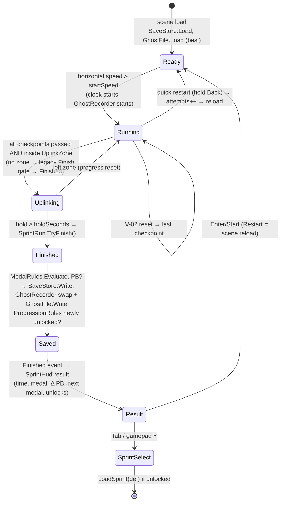

# ADR-006 — Páramo Run: module ownership of the retry loop, local save, ghosts, uplink

- **Status:** Proposed (architect, ARCH-002, 2026-10-11) · **Human owner/reviewer:** Gabriel (creative director) + Lead Dev (architecture, D-010)
- **Implements:** D-021 (north star, scaled down), D-022 (M1 = Páramo Run). **Refines:** ADR-001 (adds `Convoy.Level`), ADR-003 (surface modifiers compose with damage modifiers), ADR-005 (what is replicated vs local-only). **Proposes:** D-023..D-030 (below).
- **Specs:** `docs/specs/{UP-01,RT-01,RT-02,LV-01,LV-02,LV-03,PR-01}.md`.

## Context
D-022 turns M1 into short biome sprints (1.5–3 min) built for **retry**: medal times, live splits vs personal best (PB), a ghost of the best run, discoverable shortcuts (Rammer gate, chasm, toxic mud), an **uplink** hold at the Monolith instead of the instant finish line, and medals that unlock the next biome. Everything is offline; save data is local; no paid assets (D-021).

What exists today (verified in code, `integration` @ 2ded3c5):
- `Convoy.Race`: `SprintRun` (pure: phase Ready/Running/Finished, ordered checkpoints, elapsed, best time), `SprintController` (adapter: ticks the run in `FixedUpdate`, binds `SprintGate`s, implements `IRecoveryPointProvider`, saves best time to **PlayerPrefs** key `convoy.sprint.best.<scene>`, `Restart()` reloads the scene, `event Action Finished`), `SprintGate` (trigger; index −1 = finish).
- `Sprint_01.unity`: object `Sprint` (SprintController), `Checkpoints/Checkpoint_1..5`, `Finish` (SprintGate, trigger box 7.6 × 10 × 3 m between the Monolith pillars), `MonolithGlow`, 295 `Road_N` segments.
- `Convoy.Vehicle`: `VehicleController` (raycast wheels, per-wheel `RaycastHit` available inside the wheel loop), `VehicleState` struct, `BoostSystem`, `VehicleRecovery`.
- `Convoy.Presentation`: `SprintHud` (IMGUI, self-bootstraps next to a `SprintController`, result screen, Enter/Start → `Restart()`), `SpeedometerHud`, `VehicleAudio`, `MusicPlayer` (survives scene reloads).
- Batch 2 (ARCH-001) in flight: F-03 (seats/input), D-01 (damage; edits `VehicleController`), A-01 (AI), C-01 (camera), Q-01 (telemetry; edits `VehicleController`, reads `SprintRun`). Three of those integration tasks edit `Sprint_01.unity`.

## Decision

### 1. Module ownership

| Concern | Module (asmdef) | Main types (spec) | Why here |
|---|---|---|---|
| Run state machine, clock, checkpoints, **splits** | `Convoy.Race` | `SprintRun` (+ splits), `SprintController` | Already owns the run; splits are run data. |
| **Uplink** hold at the Monolith | `Convoy.Race` | `UplinkHold` (pure), `UplinkZone`, `UplinkConfig` SO (UP-01) | It *is* the finish rule; it must gate `TryFinish`. |
| **Medals**, sprint identity | `Convoy.Race` | `SprintDefinition` SO, `Medal`, `MedalRules` (RT-01) | Evaluated at finish from the run time. |
| **Local save** (PBs, splits, medals, attempts) | `Convoy.Race` | `SaveData`, `SaveStore`, `ISaveFileSystem` (RT-01) | Only Race writes results; one writer avoids file races. |
| **Ghost recording + file** | `Convoy.Race` | `GhostTrack`, `GhostFile`, `GhostRecorder` (RT-02) | Recording is tied to the run clock and the PB decision. Race may read `VehicleState` (Race → Vehicle is an allowed reference). |
| **Biome progression** (unlock rules, sprint list) | `Convoy.Race` | `SprintCatalog` SO, `ProgressionRules` (PR-01) | Derived purely from saved medals; no new module for ~60 lines. |
| **Surface modifiers** (toxic mud) | `Convoy.Vehicle` | `SurfaceProfile` SO, `SurfaceTag`, `SurfaceModifiers`, `WheelSurfaceCache` (LV-02) | Grip/drive are tyre-model inputs; only the vehicle can apply them per wheel. |
| **Speed-breakable walls** (Rammer gate) | **`Convoy.Level` (new, L2)** | `RammerGate`, `RammerGateConfig` SO, `RammerGateRules`, `WallFractureLayout` (LV-01) | See § 2. |
| Ghost **rendering**, split deltas, medal/result screen, uplink ring, sprint select | `Convoy.Presentation` | `GhostRenderer`, `SprintHud` edits, `UplinkHud`, `SprintSelectOverlay` | Read-only consumers (D-007). |
| Scene/prefab/asset creation (`Sprint_02`, prefabs, SO assets, Build Settings) | `Convoy.Editor` | `Assets/_Convoy/Editor/Integration/*.cs` | ADR-001 integration-script rule; builders cannot run Unity. |

### 2. Breakables: new `Convoy.Level` module, not `Convoy.Combat`
Options considered against ADR-001:
- **A. `Convoy.Combat`.** ADR-001 defines Combat as the Gunner's turret/weapons/hit-resolution module (G-01), owned by a different builder and not created yet. A Rammer gate is level geometry that reacts to *vehicle momentum*, not to weapons. Putting it there would create the Combat folder early with unrelated content and later force G-01 to share files. Rejected.
- **B. `Convoy.Vehicle`.** Vehicle would have to know about level props; every future hazard (chasm bridge terminal, mines, spider-cave triggers from D-021) would land in the busiest, most regression-sensitive module. Rejected.
- **C. `Convoy.Race`.** Breakables don't depend on run state; AI and future modes reuse them outside a sprint. Rejected.
- **D. New `Convoy.Level` (L2, references `Convoy.Core` only). Chosen.** Same shape as Combat in ADR-001: it never references `Convoy.Vehicle`; it detects a breaker by `Rigidbody` mass and closing velocity (UnityEngine types), so it can be built in parallel with LV-02/D-01 without touching `VehicleController`. Future D-021 level mechanics (bridge terminal, mines) go here. Presentation and Editor may reference it; no simulation module references it.

Physical side effect: when a gate breaks, `RammerGate` scales the breaker's horizontal velocity by `speedRetention` (one `Rigidbody.linearVelocity` write, at break time only). This is the same class of interaction PhysX performs on any collision; it is documented in the spec and is the only write Level makes to a body it does not own. In M2 the host simulates it (ADR-005: pilot-owned physics → the owner applies it on the replicated break event; noted for the spike).

### 3. Local save format — versioned JSON in `Application.persistentDataPath` (+ binary ghost files)
**Chosen:** `persistentDataPath/convoy_save.json` (profile) + `persistentDataPath/ghosts/<sprintId>.cghost` (binary, one per sprint).

| Criterion | PlayerPrefs | JSON file (chosen) |
|---|---|---|
| Where on Windows | Registry (`HKCU\Software\<company>\<product>`) | `%USERPROFILE%\AppData\LocalLow\<company>\<product>\` |
| Structured data (per-sprint splits, medals, attempts) | key-per-value strings; no lists | `[Serializable]` classes via `JsonUtility` (built-in, no package) |
| Ghost blobs (~240 KB) | base64 in the registry — wrong tool | separate binary file |
| Versioning / migration | none | `"version"` field + migration step |
| Playtest workflow | invisible; hard to back up/reset | copy/delete/attach files to a playtest report |
| Atomicity | `Save()` flush only | write `*.tmp` then `File.Replace`/`File.Move` |

- JSON schema v1 (exact classes in RT-01 spec): `{ "version": 1, "sprints": [ { "sprintId", "bestTime", "bestSplits": [..], "bestMedal", "attempts", "finishes", "vehicle", "buildVersion" } ] }`. `JsonUtility` has no dictionaries → lists, looked up linearly (≤ 10 sprints).
- **Unlocks are derived, not stored** (PR-01): `ProgressionRules` computes them from `bestMedal`, so a medal-threshold change can never leave contradictory state.
- **Read** once per scene load (`SprintController.Awake`), **written** only at finish and on `Restart()` (attempt counter). Never in a per-frame path.
- **Corrupt or newer-version file:** renamed to `convoy_save.corrupt-<yyyyMMdd-HHmmss>.json` (never deleted), start empty, `Debug.LogWarning`. Never throws into gameplay.
- **Legacy migration:** if a sprint has no record and PlayerPrefs `convoy.sprint.best.<scene>` > 0, import it as `bestTime` (no splits, no ghost, medal evaluated from it). PlayerPrefs key left untouched.
- Editor and builds share `persistentDataPath` (same company/product). Accepted for M1; PR-01 adds an editor menu that **backs up and resets** the save (renames, never deletes).
- No cloud, no accounts, no services (D-022, O-003).

### 4. Ghost recording format and memory budget
- **What:** vehicle root pose only (position + rotation) + sample time. Wheels/steer not recorded (ghost wheels stay at their prefab pose). No colliders on the ghost — non-colliding by construction.
- **Rate:** sample on the run clock in `FixedUpdate` at **25 Hz** (every 2nd step at the project's 0.02 s fixed step; accumulator-based so a different timestep still yields ~25 Hz). Playback interpolates (lerp/slerp) with a monotonic cursor (O(1) amortised). If two consecutive samples are > `TeleportDistance` = 15 m apart (a reset), playback snaps instead of interpolating.
- **Sample:** `float time` + `Vector3 position` + `Quaternion rotation` = **32 B**.
- **Cap:** `MaxSeconds` = 300 s → 7,500 samples → **240 KB per track**. Exactly **two** preallocated tracks live in memory (current recording + best for playback); on a new PB the references are **swapped**, never copied. **RAM budget: ≤ 512 KB**, 0 B allocation after `Awake`. A run longer than the cap stops recording and is not saved as a ghost (its time still counts).
- **File** `ghosts/<sprintId>.cghost`, little-endian (`BinaryWriter`): magic `"CGST"` (4 B), `ushort version = 1`, `ushort sampleRateHz`, `float finishTime`, `string sprintId`, `string vehicle` (length-prefixed), `int sampleCount`, then `sampleCount × 8 floats` (t, px, py, pz, rx, ry, rz, rw). Max ≈ 240 KB on disk.
- **Validity on load:** magic + version match, `0 < sampleCount ≤ cap`, `sprintId` matches, and `|finishTime − save.bestTime| ≤ 0.01 s`; otherwise the ghost is ignored (log), never used.
- Ghosts are **local only** and never replicated (ADR-005 note).

### 5. Uplink replaces the instant finish without breaking `Sprint_01`
- `SprintController` gains an **optional** `[SerializeField] UplinkZone _uplink` and `[SerializeField] UplinkConfig _uplinkConfig`.
  - `_uplink == null` → **legacy behaviour, unchanged**: the `Finish` `SprintGate` ends the run instantly. `Sprint_01` keeps working between UP-01b merge and UP-01c integration (and in every test that builds a sprint without a zone).
  - `_uplink != null` → `Finish` gate events are **ignored** (the gate stays in the scene, bound, harmless); every `FixedUpdate`, once `SprintRun.AllCheckpointsPassed`, `UplinkHold.Tick(dt, inside, speed)` advances; when it completes, `SprintRun.TryFinish()` is called and `Finished` fires exactly as before.
- **Inside test is geometric, not a trigger:** `UplinkZone.Contains(vehicle.State.Position)` (oriented box via `InverseTransformPoint`). Triggers stop reporting `OnTriggerStay` when a stopped Rigidbody sleeps — exactly the "hold still" case — so they are unreliable here.
- **Clock keeps running during the uplink**; the finish time is the moment the hold completes (braking into the zone is part of the skill). Leaving the zone resets progress (config: `Reset` or `Decay`). A V-02 reset during the uplink teleports to the last checkpoint → outside → progress resets.
- Telemetry (Q-01) is unaffected: `Finished` still marks the end; `race_time_s` includes the hold.
- UP-01c (integration) adds `Uplink` object to `Sprint_01` at the `Finish` gate pose and wires it. Nothing is deleted.

### 6. Restart
Restart stays a **scene reload** in M1 (`SprintController.Restart()`): it resets breakables, debris, AI, physics for free. Target: input → car controllable again **≤ 2.0 s** on Gabriel's PC (RT-01 AC). Persistent things survive the reload by design: the save file and ghost file (disk), `MusicPlayer` (`DontDestroyOnLoad`). RT-01 adds a **quick restart** anywhere in a run (hold Backspace / gamepad Back 0.4 s). An in-place reset (no reload) is deferred until playtests show the reload hurts retry (D-029).

### 7. Run loop

`Uplinking` is not a new `SprintPhase` value: it is `Phase == Running && AllCheckpointsPassed && UplinkHold.Inside`, exposed for the HUD via `SprintController.Uplink` (read-only). This keeps `SprintRun`'s public enum stable for Q-01.

### 8. Execution order additions (ADR-001 table)
| Order | Component | Why |
|---|---|---|
| 0 | `SprintController` (now also ticks `UplinkHold`) | unchanged slot; reads last tick's `VehicleState` (one-step latency, 20 ms, acceptable) |
| +40 | `GhostRecorder` (RT-02) | sample the pose after the vehicle simulated this step, before telemetry |
| +50 | `RaceTelemetry` (Q-01b) | unchanged |
`RammerGate` reacts in `OnTriggerEnter/Stay` (physics callbacks, after the simulation step). `WheelSurfaceCache` runs inside `VehicleController.FixedUpdate`.

### 9. File-conflict serialisation (who edits what, in which order)
| File | Edited by (in order) |
|---|---|
| `Scripts/Race/SprintController.cs` | UP-01b → RT-01b → PR-01b |
| `Scripts/Race/SprintRun.cs` | RT-01a only |
| `Scripts/Presentation/SprintHud.cs` | RT-01b → PR-01b |
| `Scripts/Vehicle/VehicleController.cs`, `VehicleState.cs` | D-01b → Q-01b → LV-02b |
| `Tests/PlayMode/Convoy.Tests.PlayMode.asmdef` | D-01b (creates) → A-01b → UP-01b → LV-01b → LV-02b |
| `Editor/Convoy.Editor.asmdef` | F-03c (creates) → … → LV-01c (adds `Convoy.Level`) |
| `Scenes/Sprint_01.unity` (orchestrator) | F-03c → A-01c → C-01b → UP-01c → RT-01c |
| `Scenes/Sandbox.unity` (orchestrator) | F-03c → C-01b → LV-01c → LV-02c |
| `Scenes/Sprint_02.unity` (new, orchestrator) | LV-03b only |
| `ProjectSettings/EditorBuildSettings.asset` (orchestrator) | LV-03b |

### 10. Changes made to existing ADRs/specs (consistency edits in this task)
1. **ADR-001:** `Convoy.Level` added to the layer diagram, module table and asmdef list; Race and Vehicle responsibility lines extended; execution-order table gains `GhostRecorder` (+40); integration scripts must expose `ApplyToScene(string scenePath)` so new biome scenes reuse them (LV-03b).
2. **ADR-003:** note that `SurfaceModifiers` (LV-02) multiply with `HandlingModifiers` and are likewise exactly 1 outside zones.
3. **ADR-005:** list of replicated state gains run/uplink state; ghosts and save data are local-only.
4. **D-01 spec:** Blocks list gains LV-02b (same `VehicleController.cs`).
5. **Q-01 spec:** Q-01b Blocks LV-02b; `finished`/`race_time_s` semantics with uplink; `splits_s` may read `SprintRun.GetSplit` once RT-01a is merged.
6. **F-03, C-01, A-01 specs:** their integration scripts expose `ApplyToScene(string scenePath)` (one line each).

## Consequences
- + Every retry driver is testable in EditMode as pure logic (`UplinkHold`, `MedalRules`, `SprintRun` splits, `GhostTrack`, `SaveData` round-trip, `ProgressionRules`, `RammerGateRules`, `SurfaceModifiers`).
- + `Sprint_01` never breaks: uplink is opt-in per scene; surface/damage multipliers are exactly 1 by default.
- + Save data is inspectable/backup-able for playtests; no services, no cost.
- − `SprintController` is edited by three tasks in sequence (UP-01b → RT-01b → PR-01b); mitigated by strict per-spec edit lists.
- − Scene reload restart (~1–2 s) is slower than an in-place reset; measured, revisited by D-029.
- − One more asmdef (`Convoy.Level` + its test asmdef).

## Proposed decisions
To be copied into `DECISIONS.md` by a human (architect does not edit it).

- **D-023 — `Convoy.Level` module** · Proposed · Owner: Lead Dev — New L2 asmdef `Convoy.Level` (references `Convoy.Core` only) for interactive level pieces: Rammer gate now; chasm bridge terminal, mines later. Never references Vehicle; no simulation module references it.
- **D-024 — Local save = versioned JSON + binary ghosts in `persistentDataPath`** · Proposed · Owner: Gabriel — `convoy_save.json` (schema v1, `JsonUtility`, atomic write, corrupt → renamed backup) and `ghosts/<sprintId>.cghost`. PlayerPrefs only read once for legacy best-time migration. No online services.
- **D-025 — Uplink finish** · Proposed · Owner: Gabriel + ND — Finish = hold inside the Monolith `UplinkZone` for `holdSeconds` (default 4 s); leaving resets; the clock runs during the hold; geometric inside-test; scenes without a zone keep the instant finish gate.
- **D-026 — Ghost format & budget** · Proposed · Owner: Lead Dev — Best run only, 25 Hz root pose (32 B/sample), cap 300 s, two preallocated tracks ≤ 512 KB RAM, 0 B per-frame GC, rendered by Presentation with no colliders, local only.
- **D-027 — Surface modifiers via ground-collider tags** · Proposed · Owner: Gabriel — Per-wheel lookup of a `SurfaceTag` on the collider hit by the suspension ray (no trigger volumes); multipliers default to exactly 1; nitro push unaffected by surfaces (counterplay to mud).
- **D-028 — Sprint identity, medals and unlocks** · Proposed · Owner: Gabriel + ND — One `SprintDefinition` SO per biome (stable `sprintId`, scene name, Bronze/Silver/Gold/Monolith times, inclusive at hundredths); `SprintCatalog` lists sprints in order with unlock rules; unlocks are derived from saved medals, never stored. Toxic Wastes requires Silver in Red Canyon.
- **D-029 — Restart = scene reload in M1** · Proposed · Owner: Gabriel — Target ≤ 2.0 s to control; quick restart anywhere (hold Back 0.4 s). In-place reset only if PT data shows the reload hurts retries.
- **D-030 — Integration scripts are scene-parametric** · Proposed · Owner: Lead Dev — Every integration script exposes `public static void ApplyToScene(string scenePath)` (menu items call it for their default scenes), so a generated biome scene (LV-03b) reuses F-03c/C-01b/UP-01c/RT-01c wiring instead of duplicating it.
