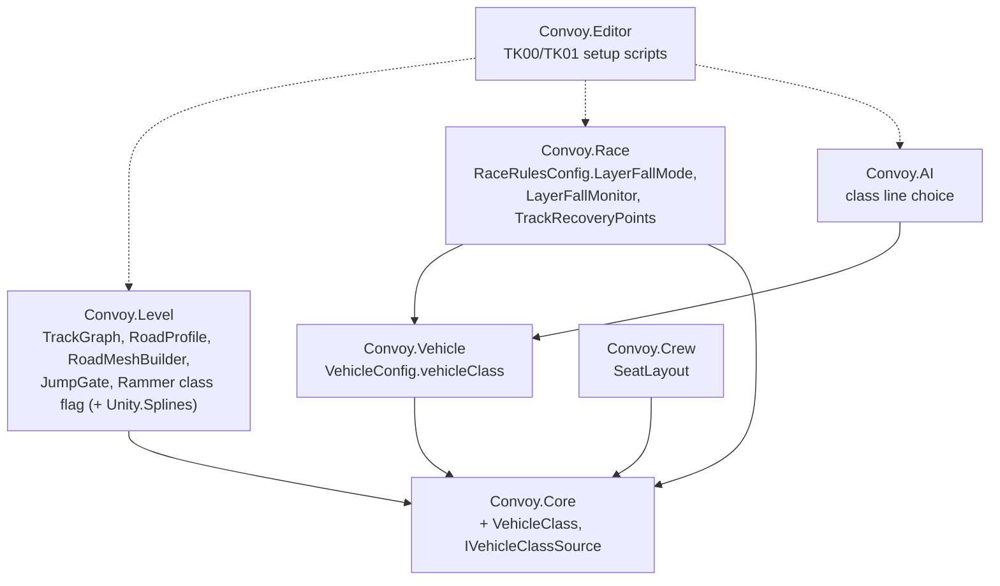

# ADR-007 — MVP track kit, vehicle classes, class-gated pieces, layer falls

- **Status:** Proposed (architect, ARCH-003, 2026-10-12) · **Human owner/reviewer:** Lead Dev (architecture) + Gabriel
- **Refines:** D-035 (MVP), D-036 (track tech), D-037 (T01 topology), ADR-001 (modules), ADR-006 (Páramo Run). **Proposes:** D-038 (below).
- **Inputs:** `docs/tracks/T01/T01_topology.md` + `.json`, `docs/BACKLOG_MVP.md`.

## Context
The MVP is one ~10 km multi-level sprint, T01, raced by three vehicle classes that each have their own lines. Four things are new to the code base:
1. Roads that stack: bridges, tunnels and over/under crossings. Unity Terrain cannot do this (D-036).
2. Vehicle classes: sidecar, JACKAL and heavy, with different handling, seats, damage and access to pieces.
3. Pieces only one class can use or open (narrow passages, breakable walls, speed-gated jumps).
4. Falling from an upper layer onto a lower one, as a config toggle (O-004).

The existing code already covers part of this. `VehicleController` takes any number of wheels (`Wheel[]` with `steers` / `driven` / `rear`), so a three-wheel rig needs no new physics. `RammerGateRules` breaks by mass and speed. `ChasmJump.MinClearSpeed` gives jump ballistics. `IRecoveryPointProvider` is the reset hook (V-02). `RouteRecoveryPoints` resets to the nearest route point. AI follows `PolylinePath` racing lines (D-019).

### Unity background (for reviewers new to Unity)
- **Unity Splines** (`com.unity.splines`, free, first-party) stores a Bézier curve as a component (`SplineContainer`). Its `SplineExtrude` builds a simple tube or road mesh along the curve. For a flat road with a custom cross-section we write a small generator that samples the spline and builds the mesh + `MeshCollider`. That is what TK-00 proves.
- **ProBuilder** (already in the project) is for hand-shaped pieces: ramps, tunnel mouths, walls.
- A **MeshCollider** made from the road mesh is what the wheel raycasts hit. Seams between two road meshes are where wheels "snag", so the generator welds the ends: same vertices, same normals.

## Decision

### 1. Track kit lives in `Convoy.Level` (data + maths) and `Convoy.Editor` (generation)
| Type | Module | Kind | Responsibility |
|---|---|---|---|
| `TrackGraph` | Level | plain C# + `[Serializable]` data | Nodes and typed edges loaded from `T01_topology.json`-style data: ids, edge type (`A`, `B`, `Shared`, `Sidecar`, `Heavy`, `Jackal`), layer index, level type of crossings. No `MonoBehaviour`. |
| `TrackEdgeKind`, `LayerIndex` | Level | enums / int | Edge types and layer (0 = low, 1 = mid, 2 = high). |
| `RoadProfile` | Level | `ScriptableObject` | Cross-section per road type: width, camber, shoulder, surface (`SurfaceProfile` ref), guard-rail flag. A = narrow/rough, B = wide/smooth (D-037). |
| `RoadMeshBuilder` | Level | static, pure | Samples a list of spline points into vertices/triangles/UVs for a `RoadProfile`; welds ends. EditMode-testable (no scene). |
| `TrackSegmentAuthoring` | Level | thin `MonoBehaviour` | Holds the `SplineContainer` refs + `RoadProfile` per edge in a segment scene; editor tooling and AI export read it. |
| `TK00_TrackKitSetup`, `TK01_Segment1Setup` | Editor | integration scripts (ADR-001) | Idempotent, never deleting, `ApplyToScene(path)`: build road meshes + colliders from the authoring splines, place class pieces, bake recovery and racing-line data. |

- `Convoy.Level` gets one new package reference: `Unity.Splines`. That is a new package, so it needs a decision entry: D-036, confirmed by TK-00.
- **Why the meshes are generated in the editor, not at runtime:** baked meshes are just assets. They give zero runtime cost, deterministic colliders and diffable output, and they follow the integration-script rule (D-016, D-030).

### 2. Vehicle classes: data, not types
- **`VehicleClass` enum in `Convoy.Core`** (`Sidecar = 0, Jackal = 1, Heavy = 2`). It sits in Core because Level, Crew, AI, Race and Presentation all need to read it, and Core is the only module they all reference. It is engine-free.
- **`VehicleConfig` gains `public VehicleClass vehicleClass`.** Each class has its own `VehicleConfig` asset (`Config/Vehicles/{Sidecar,Jackal,Heavy}_VehicleConfig.asset`), its own `DamageConfig`, and a per-class `ClassTraction` table (below). No subclasses, and no `switch` on class in `VehicleController`: differences are numbers.
- **The vehicle tells others its class through an `IVehicleClassSource` interface in Core** (`VehicleClass Class { get; }`). `VehicleController` implements it. Level pieces read it with `GetComponentInParent<IVehicleClassSource>()` on the collider's attached body, so **Level still does not reference Vehicle** (ADR-001 holds).
- **Seats per class live in `Convoy.Crew`.** A `SeatLayout` `ScriptableObject` lists the seats a vehicle has (sidecar: Pilot + Gunner; JACKAL: Pilot + Gunner + Engineer; heavy: Pilot + Gunner + Engineer). `VehicleSeats` gets a `[SerializeField] SeatLayout`. Joining a missing seat is refused, and the join order skips it (F-03 amend).
- **Sidecar lean is presentation only.** A `SidecarLeanVisual` in Presentation tilts the body mesh from `VehicleState` (lateral acceleration). Physics stays a three-wheel rigid rig (D-004, BACKLOG_MVP VH-01).

### 3. Class-gated pieces (Level): physical gates, never locks (D-037)
| Piece | Gate | How |
|---|---|---|
| Narrow passage / tunnel (sidecar) | geometry | Clear width less than the JACKAL track width + 0.2 m. No code: a `ClassGateCheck` editor validation asserts the widths from each class's wheel layout. |
| Rammer wall (heavy) | class + speed | `RammerGateRules.ShouldBreak` gets a class check: `RammerGateConfig.breakerClasses` (flags, default `Heavy`). Mass/speed thresholds stay as a second condition, so tuning still works. Breaks stay open; debris slows followers (D-037). |
| Speed-gated jump (JACKAL) | speed | `JumpGate` (Level) stores gap, ramp angle and landing drop; the editor check computes `ChasmJump.MinClearSpeed`. Any class may try. Only the JACKAL's top speed + boost clears it with a margin (config `JumpGateConfig.clearMarginMps`). A failed jump drops the car to the layer below → §4. |
| Fragile bridge (heavy collapses, CL-01) | mass | Reuses Rammer gate maths on a horizontal piece. CL-01, not Phase 1. |

### 4. Layer falls (O-004): a Race-side toggle on the recovery provider
- **`LayerFallMode` enum in Race:** `LandAndContinue`, `ResetToRoute` and `Hybrid` (lands where a road is below, resets over voids). It is set in `RaceRulesConfig` (Race, `ScriptableObject`). Default **`Hybrid`**, the Lead AI recommendation; PT-A decides.
- **Fall detection:** `LayerFallMonitor` (Race, MonoBehaviour per vehicle) tracks the last layer the car was grounded on. Each layer has its own physics layer mask on the road colliders (`Road_L0..L2`), so a wheel raycast hit tells you the layer, and a collider lookup is not needed. "Fell" means: airborne for more than `fallMinAirSeconds` **and** the next grounded layer is lower than the last one.
  - `LandAndContinue`: nothing happens (the lower road is a valid route). Telemetry logs the fall.
  - `ResetToRoute`: calls the vehicle's existing reset with the route recovery pose on the **original** layer.
  - `Hybrid`: if no road collider is found under the car within `voidProbeMetres` after `fallMinAirSeconds`, reset (void). Otherwise land.
- **Recovery must become layer-aware.** `RouteRecoveryMath.Nearest` ignores height on purpose (TR-01c), which picks the wrong road at stacked crossings. The new `TrackRecoveryPoints` (Race, implements `IRecoveryPointProvider`) stores a layer index per route point and searches only the layer the car was last grounded on. On open terrain the old `RouteRecoveryPoints` stays as it is.

### 5. AI racing lines come from the same splines (D-019)
- `TK01_Segment1Setup` samples each edge spline at 5 m into a `RacingLine` (existing component) per route choice: A-only, B-only and each class line. A rival picks its line by class (`AiDriverProfile.vehicleClass` + a line list).
- **Check for stacked roads:** `PolylinePath.ProjectGlobal` measures distance in 3D, but `Project(hint, window)` uses a local window. After a reset, AI must call `ProjectGlobal` on **its own line only**, never across lines. TK-00 adds a test with two stacked lines 8 m apart.

### Module diagram (changes only)

No new assemblies. The only new external reference is `Convoy.Level → Unity.Splines`.

## Impact review of open tasks (ARCH-003 AC 3)
| Task | Verdict | Change |
|---|---|---|
| LV-01 Rammer gate | **amend** | Add `breakerClasses` to `RammerGateConfig`; `ShouldBreak` requires the class flag **and** mass/speed. Class is read via `IVehicleClassSource` (Level stays Core-only). LV-01b's existing tests keep passing with `breakerClasses = All`. New test: JACKAL at break speed does not break a `Heavy`-only wall. LV-01c places walls in TK-01 instead of `Sprint_01`/`Paramo_01`. |
| LV-02 Mud | **amend** | `SurfaceProfile` multipliers become per class through a `ClassTraction` table (Vehicle): `{class, frictionScale, driveScale, topSpeedScale}` applied on top of the surface. Heavy ≈ 0.85 penalty, sidecar ≈ 1.25 (worst). LV-02b/c continue; numbers in SO only. |
| F-03 Seats | **amend** | `SeatLayout` SO per class (sidecar = Pilot + Gunner). `VehicleSeats` refuses a seat that is not in the layout; the join order skips it. F-03c integration adds the layout asset to each vehicle prefab. |
| D-01 Damage | **amend (data only)** | One `DamageConfig` per class: sidecar fragile (lower `maxHealth`, higher `impactDamagePerMps`), heavy armoured. No code change. D-01c wiring uses the class asset. |
| A-01 Rivals | **keep + follow-up** | Keep `Sprint_01` as A-01's test course. AI-03 (Phase 2) adds one rival per class on SEG1 using class lines from §5. |
| C-01 Camera | **amend (data only)** | One camera rig profile per class (sidecar low and fast, heavy large/far). C-01a builds it as a profile SO keyed by `VehicleClass`; no per-class code. |
| UP-01 Uplink | **keep** | Keep the `Sprint_01` integration. The uplink moves to SEG4 (TK-04); no spec change now. |
| TR-01c | **paused** (already merged in #12) | No further open-terrain work. **TR-01a terrain synthesis is reused** for the T01 backdrop/low ground (D-036): `TerrainSynthesis` generates the surrounding heightmap from the T01 bounding box; roads are meshes on top. |

## Consequences
- + Three classes and class pieces with no new physics model and no new assemblies.
- + Layer falls are a config toggle with three modes, so PT-A data decides O-004.
- + The topology data (`T01_topology.json`) drives meshes, recovery and AI lines from one source.
- − One new package (`com.unity.splines`). It is first-party and free, but still a dependency to keep in step with Unity upgrades.
- − Each class needs its own tuning pass (VehicleConfig, DamageConfig, traction, camera). Budgeted in VH-01/VH-02.
- − The road mesh generator is our code: seams and UVs are ours to debug. TK-00 exists to find out if it is cheap enough; the fallback is ProBuilder-only roads for SEG1.

## Proposed decisions
**D-038 — MVP class & track architecture (ADR-007)** · Status: Proposed (architect) · Owner: Lead Dev
- `VehicleClass` + `IVehicleClassSource` in Core; classes are data (`VehicleConfig`, `DamageConfig`, `ClassTraction`, `SeatLayout`, camera profile), never subclasses.
- Track kit in Level (graph, road profiles, pure mesh builder) + editor setup scripts; meshes baked in the editor, layer per physics layer `Road_L0..L2`.
- Class gates are physical: geometry (sidecar), class flag + speed (heavy walls), speed (JACKAL jumps).
- O-004 = `RaceRulesConfig.layerFallMode` {LandAndContinue, ResetToRoute, Hybrid}, default Hybrid; recovery is layer-aware (`TrackRecoveryPoints`).
- AI racing lines are sampled from the same splines; one line per class route.
