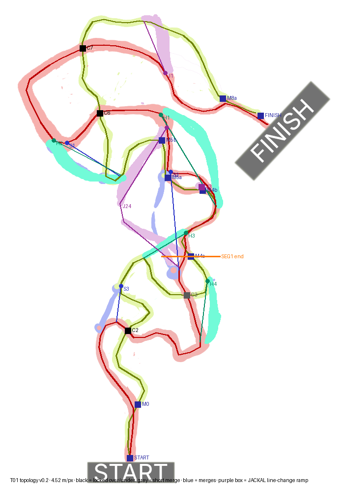

# T01 — Topology v0.2 (digitized hand map + Gabriel's answers)

- **Status:** Draft v0.2 (architect, ARCH-003, 2026-10-12; Gabriel's answers folded in) · **Human owner:** Gabriel (layout) + Narrative & Game Designer
- **Source:** `T01_map_*.png` (Gabriel's hand map, D-037) · **Machine-readable:** `T01_topology.json` · **Overlay:** `T01_topology_overlay.png`
- **How it was made:** main lines A and B were traced from the single-colour images (colour mask → skeleton → shortest path START→FINISH, 25 px samples). Connectors were placed from the perk images. Directions confirmed by Gabriel are marked; the rest assume the race runs bottom → top.

## Scale and placement
| Item | Value |
|---|---|
| Scale | **4.52 m per map pixel**: the mean START→FINISH length of A (2194 px) and B (2232 px) is set to 10 km (D-035) |
| Main A / Main B length | 9.92 km / 10.09 km |
| Bounding box | 2.28 km (x) × 4.09 km (z) |
| World origin | map px (285, 760), the centre of the drawing; world x = map right, world z = map up |
| Farthest point from origin | 2.34 km: inside the 5 km float-precision limit (D-035). It does **not** fit the "~3 × 3 km" wording; the 5 km limit is the real rule |
| Heights | not assigned yet; TK-01 assigns layers at the crossings below |

## Nodes (where A and B meet)
| Node | Kind | Proposed level type | A arc (m) | B arc (m) | Notes |
|---|---|---|---|---|---|
| START | start | — | 0 | 0 | shared start straight (~0.5 km, wide: pack spreads out) |
| M0 | split | — | 515 | 452 | end of the shared start |
| C2 | crossing | **over/under, locked (signature 1)** | 1347 | 1546 | first layer moment, teaches the stack |
| C3 | crossing | short merge (~100 m shared) | 2937 | 2870 | contact point; line change allowed |
| M4a–M4b | merge | shared road (~0.85 km) | 3489–4352 | 3263–4063 | **segment 1 ends at M4a**; **J3** JACKAL line-change ramp at M4b |
| M5a–M5b | merge | shared road (~0.35 km) | 4709–5066 | 4456–4777 | |
| C6 | crossing | **over/under, locked (signature 2)** | 6394 | 5617 | A lobe vs B top-left loop |
| C7 | crossing | **over/under, locked (signature 3)** | 7050 | 7343 | |
| M8a–FINISH | merge | shared final run (~1 km) | 8875–9916 | 8943–10086 | to the Monolith uplink |

## Sections A vs B (between nodes)
Geometric length is solid. The time column uses a **placeholder speed model** (average A 30 m/s, B 38 m/s, shared 34 m/s) that TK-00 must replace with measured JACKAL speeds.

| Section | A (m) | B (m) | Longer | Δ time, model (s) |
|---|---|---|---|---|
| M0 → C2 | 831 | 1094 | B +263 | 1.1 ✓ |
| C2 → C3 | 1591 | 1324 | A +267 | 18.2 ✗ |
| C3 → M4a | 551 | 393 | A +158 | 8.0 ✗ |
| M4b → M5a | 357 | 393 | B +36 | 1.6 ✓ |
| M5b → C6 | 1329 | 840 | A +489 | 22.2 ✗ |
| C6 → C7 | 655 | 1726 | B +1071 | 23.6 ✗ |
| C7 → M8a | 1826 | 1600 | A +226 | 18.8 ✗ |

**Finding 1: line-hopping beats both lines.** If every crossing lets you switch, the fastest run mixes lines (B up to C6, A from C6 to C7, B after). In the model that run takes 246 s, against 274 s for B only and 320 s for A only. B's top-left loop (C6→C7) is 1.07 km longer than A. A's lobe (M5b→C6) is 0.49 km longer than B.

**Decided (Gabriel left it to the architect, 2026-10-12): C2, C6 and C7 are over/under with no connection.** Line changes then happen only at merges (M0, C3, M4, M5, M8). The locked stretch M5b→M8a gives A 3.81 km and B 4.17 km, so the lengths nearly cancel and the remaining gap is only the speed model. After TK-00 measures real A/B speeds, shorten A by about 15–20 % on M0→C3 and M5b→M8a, or make A's surface less slow. Target: Δ ≤ 2 s per ~60 s section (D-037).

## Class connectors
"Gain" = metres saved against the best way to the same point on the mains, starting from the line the connector leaves.

| Id | Class | From → to | Length (m) | Gain (m) | Verdict |
|---|---|---|---|---|---|
| S3 | sidecar | B@1415 → A@2006 (narrow cut after C2) | 746 | ~45 | too small to matter → make it a real cut or drop it |
| S2 | sidecar | B@3118 → B@4456 (tunnel past B's mid S) | 926 | **411** | **too big** (HANDMAP 6): shorten or slow it (≈ 10 s today) |
| S1 | sidecar | A@5649 → B@6015 (A lobe bottom → B loop, skips C6) | 542 | 600 | **side by side with H2** as one contact corridor (answer 4); trim the gain to ≤ ~3 s |
| H4 | heavy | B@2418 → A@3218 (wall before M4) | 628 | ~104 | fine (≈ 3 s) |
| H3 | heavy | A@2354 → M4 (diagonal across A's lobe, triple crossing) | 452 | **732** | **biggest shortcut on the map**: cap it with a slow breakable section or move its exit back |
| H1 | heavy | M4@4149 → B@5016 (parallel brute line) | 1116 | ~0 | good "own line" with no shortcut; keep, tune by surface |
| H2 | heavy | A@5635 → B@6142 (lobe bottom → B loop) | 832 | 438 | contact corridor with S1: the heavy can wreck the sidecar (impact damage, D-01) |
| J1 | jackal | A@7791 → B@8193 (top jump, **A→B confirmed**) | 637 | −407 | loses distance but skips rough A: ≈ +2–3 s under the model, fine |
| J24 | jackal | B@3141 → B@4885 (jump over the triple crossing, lands on its own track, rejoins B near M5b; **confirmed**) | 1640 | 104 | ≈ +5 s under the model, a little high: tune the landing track |

**J3** (purple dot on M4b) = JACKAL ramp that changes line at the end of M4 (answer 3). Because C2, C6 and C7 are locked, this ramp is the JACKAL's private line-change point.

**Finding 2: perk balance (v0.2).** With J24, J1 and J3 the JACKAL now has its lines. Still too big: H3 (~730 m) and S2 (~410 m); tune them to ≤ ~3 s in CL-01. The target stays per-class gain within ±5 % of the run (D-035).

## Segments (proposal)
| Segment | Task | From → to | Length |
|---|---|---|---|
| SEG1 | **TK-01** | START → M4a | A 3.49 km · B 3.26 km |
| SEG2 | TK-02 | M4a → C6 | A 2.91 km · B 2.35 km |
| SEG3 | TK-03 | C6 → M8a | A 2.48 km · B 3.33 km |
| SEG4 | TK-04 | M8a → FINISH (Monolith uplink) | ~1.1 km + finale |

SEG1 is longer than the 2.5 km in the backlog, but it is the natural cut. It contains signature crossing C2, the short merge C3, connectors S3/H4/H3/S2-entry and the triple-crossing stack (HANDMAP 4), so it has everything PT-A must judge. Phase 1 builds SEG1 with JACKAL only and keeps the connector ends as blocked stubs (CL-01 opens them).

## Learnable section and jumps
- Long learnable sections (≥ 60 s at the model speed): C7→M8a on A (1.83 km, ~61 s) and B's top-left loop C6→C7 (1.73 km, ~45 s). Pick one in TK-03 to be the "learn it" section.
- There are no mandatory jumps on the mains. Every jump is an optional class connector, so the beginner rule is met as drawn.

## Answers (Gabriel, 2026-10-12)
1. **J4 / J2** are one JACKAL line (**J24**): the jump lands on its own track, which then joins Main B.
2. **J1** runs A → B, as assumed.
3. **J3** is a ramp that lets you change line (JACKAL).
4. **S1 / H2** run side by side. The heavy can badly damage the sidecar. Gabriel also wants the heavy to be open to robbery by the sidecar, but **robbery is post-MVP (D-032)**. MVP: contact and impact damage only; the corridor is the place robbery plugs in later.
5. **Locking C2/C6/C7:** left to the architect. **Locked** (see Finding 1).
